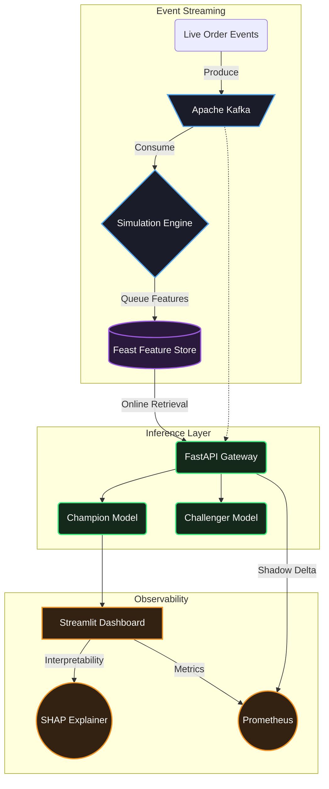

# DeepPrep — Food-Preparation-Time Prediction with Queueing-Theory Features

[](https://github.com/susmitgoswami5/DeepPrepMLOps-Platform/actions/workflows/tests.yml)

DeepPrep predicts how long a restaurant will take to prepare an order, and the upper tail of that time (P90/P95), which matters most for delivery promises. It combines a PyTorch **Wide & Deep** quantile model with **M/M/c (Erlang C) queueing estimates** of kitchen congestion, and wraps it in a small MLOps stack: Kafka event streaming, a Feast feature store, a FastAPI service with champion/challenger shadow routing, SHAP explanations, drift monitoring and scheduled retraining.

> **Data note.** All results use **simulated** order data (described below). They show that the method and pipeline work under controlled conditions; they are not claims about real restaurants.

---

## Research question

Do explicit queueing-theory features (expected wait, utilisation, queue length) improve preparation-time predictions, especially the P95 tail, compared with a model that only sees raw recent order counts?

## How the data is simulated

`src/data/mock_generator.py` simulates each of 20 restaurants as a **multi-cook, first-come-first-served kitchen**:

- **Arrivals:** a non-homogeneous Poisson process with lunch and dinner peaks, generated by thinning.
- **Service time:** depends on the items in the order (the slowest item plus assembly time for extra items), the kitchen's speed and log-normal noise.
- **Waiting:** an order starts only when one of the restaurant's cooks (2–4, from `src/data/restaurant_profiles.py`) is free.
- **Target:** `target_fpt_minutes` = waiting time + service time. Preparation time therefore genuinely rises with kitchen load (correlation with last-hour order count ≈ 0.3–0.4 across seeds).

## Model

| Part | Inputs |
|---|---|
| Wide side | restaurant embedding, cyclic hour/day features, item embeddings, M/M/c features |
| Deep side | LSTM over the 15/30/60-minute rolling order counts |
| Output | three quantile heads (P50, P90, P95), trained with pinball loss |

Count and wait-time inputs are `log1p`-scaled inside the model, so training and serving always apply the same transform. The M/M/c features use the last hour's order count as the arrival rate λ, the restaurant's cook count as *c*, and its service speed as μ (`src/features/queue_engine.py`). This code is unit-tested against an independent Erlang C implementation and Little's law.

## Results

Reproduce with `make evaluate` (≈ 5 minutes on a laptop CPU).

Simulated orders: 15000 per seed · chronological 80/20 split · seeds [0, 1, 2] · mean ± std

| Model | P50 MAE (min) ↓ | P95 coverage (target 0.95) | P95 pinball loss ↓ |
|---|---|---|---|
| Constant baseline (training-set quantiles) | 9.54 ± 1.04 | 0.945 ± 0.017 | 1.870 ± 0.499 |
| **DeepPrep (Wide & Deep + queue features)** | 5.56 ± 0.68 | 0.927 ± 0.015 | 1.088 ± 0.303 |
| DeepPrep without queue features (ablation) | 5.50 ± 0.45 | 0.922 ± 0.015 | 1.049 ± 0.229 |
| Gradient-boosted quantile regression, same inputs | 4.69 ± 0.51 | 0.915 ± 0.017 | 1.024 ± 0.266 |
| Gradient-boosted quantile regression + item count | 4.63 ± 0.50 | 0.920 ± 0.017 | 1.013 ± 0.274 |

**What this shows**

1. **The model learns real signal:** P50 error falls by about 42% compared with a constant prediction, and P95 pinball loss falls by about 42%.
2. **The queueing features did not add measurable accuracy** on top of the raw load counts. The differences are within one standard deviation across seeds. A likely reason: the M/M/c features are a deterministic function of last-hour load and restaurant identity, both of which the network already receives, so it can learn the relationship directly. The hypothesis is therefore **not supported** under this setup.
3. **A gradient-boosted quantile baseline is still ~15% more accurate** at P50. On small tabular problems this is common, and it sets the bar any neural model has to clear.
4. **P95 coverage is slightly below target** (0.92–0.93 vs 0.95) for every model, because the test period is later in time than training. A conformal calibration step would be a natural fix.

**Bug found during evaluation.** An earlier version reshaped targets to `(batch, 1, 1)`. Inside the quantile loss this broadcast against `(batch, 1)` predictions, so every prediction was compared with every target in the batch, and the model collapsed to a constant (no better than the baseline). `quantile_loss` now forces the target shape, and `tests/test_model.py` contains a regression test.

**Next steps:** test settings where queueing features should matter more (very little data, unseen restaurants, sudden surges), add item count and order complexity as inputs, and add conformal calibration for the P95 head.

---

## System architecture



| Component | Where |
|---|---|
| Event streaming (Kafka producer/consumer, weather stream) | `src/streaming/` |
| Feature store (Feast: Parquet offline, Redis online) | `src/feature_store/` |
| Serving: FastAPI with champion/challenger shadow routing, Prometheus metrics, SHAP `/explain` | `src/api/router.py` |
| Monitoring: Streamlit dashboard, Evidently drift report | `src/monitoring/` |
| Training core shared by pipeline, retraining and evaluation | `src/training/core.py` |
| Scheduled retraining + validation gate (GitHub Actions) | `scripts/`, `.github/workflows/` |
| Kubernetes manifests | `k8s/` |

The validation gate (`scripts/validate_model.py`) promotes a retrained challenger only if it reduces P95 pinball loss by at least 1% on a fixed held-out set.

---

## Quick start

**Run the model code (no Docker needed):**

```bash
pip install -r requirements.txt
make test                      # unit tests
make evaluate                  # held-out evaluation and ablation -> evaluation/results.md
python -m src.training.pipeline  # train and save models/deep_prep_weights.pth
```

**Run the full stack** (Redis, Kafka, API on :8000, dashboard on :8501):

```bash
make up        # docker-compose up -d --build
make down
```

API docs: `http://localhost:8000/docs` · Dashboard: `http://localhost:8501` · End-to-end API smoke test: `python scripts/smoke_test_api.py` (needs the stack running).

## Project structure

```text
├── evaluation/            # evaluate.py, results.md, results.json
├── k8s/                   # Kubernetes manifests
├── models/                # trained weights, restaurant mapping, training metadata
├── scripts/               # retrain.py, validate_model.py, smoke_test_api.py
├── src/
│   ├── api/               # FastAPI service
│   ├── data/              # restaurant profiles + queue-based order simulator
│   ├── feature_store/     # Feast definitions
│   ├── features/          # feature engineering + M/M/c queue engine
│   ├── model/             # Wide & Deep quantile model
│   ├── monitoring/        # Streamlit dashboard, drift detection
│   ├── streaming/         # Kafka producers/consumers
│   └── training/          # shared training core, dataset, Prefect flow
└── tests/                 # unit tests (queueing maths, simulator, model)
```

## Limitations

- **Simulated data:** the simulator's assumptions (Poisson arrivals, FCFS, fixed cook counts) are simplifications of real kitchens.
- **Known capacity:** cook counts are treated as known; in practice they would need to be estimated.
- **Data size:** results come from about 10 simulated days per seed, so the variance across seeds is non-trivial.

## Author

Susmit Goswami — B.Tech CSE (AI & ML), Techno Main Salt Lake, Kolkata · [GitHub](https://github.com/susmitgoswami5) · [LinkedIn](https://www.linkedin.com/in/susmit-goswami-33784542a/)

Released under the MIT License.
